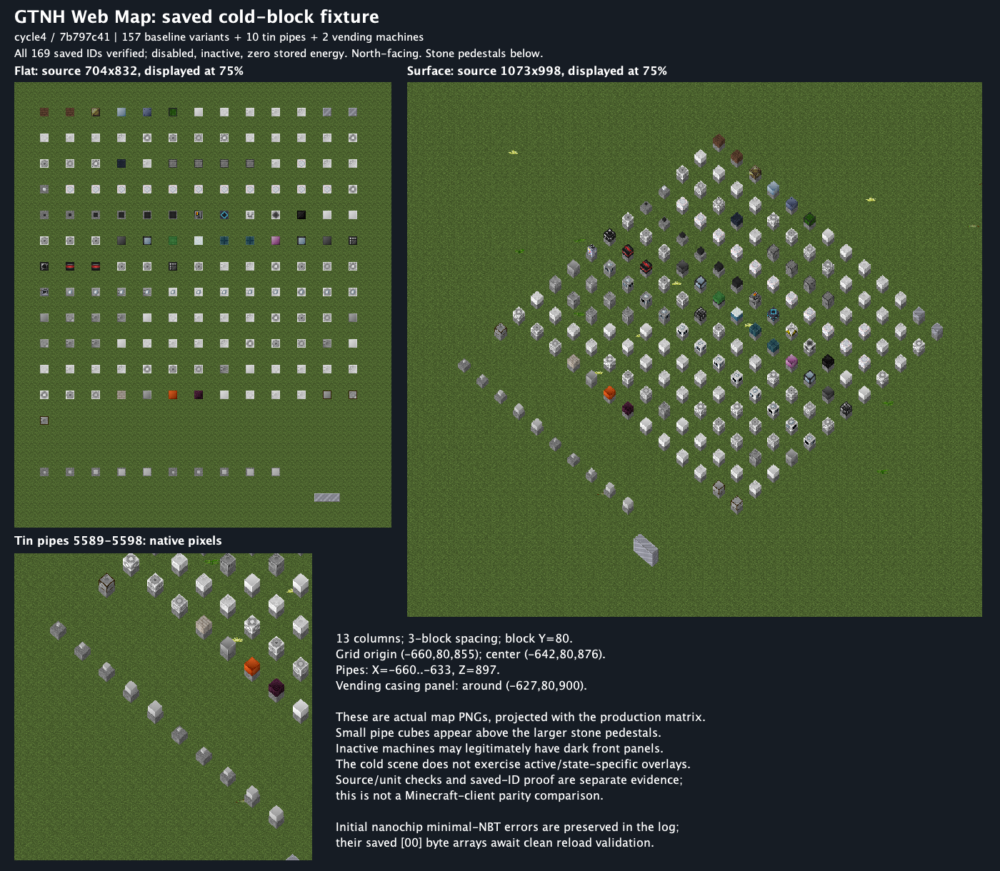

# Saved cold-block rendering fixture

Cycle 4 (`7b797c41`, artifact SHA-256
`92217f3adac680dbabefef51634d40161d92e06437d06d3382845bf6e4293709`)
placed and saved all 157 baseline unsupported variants, ten additional tin pipe
examples (5589–5598), and two extra vending machines beside seven casing blocks.
All 169 saved tile entities match the requested MTE ID and block metadata; all
are disabled, inactive, and store no energy. The per-block manifest is
[runtime-fixture/cold-scene-manifest.csv](runtime-fixture/cold-scene-manifest.csv).



This scene exists only in `/private/tmp/gwm-fixture/Fixture`. Its Minecraft
server binds to `127.0.0.1:25566`; the fresh world is named `Fixture`, uses the
flat generator, and has no production world/account state. The reusable
`tools/runtime-fixture/cold_scene.py` requires that exact fixture directory and
checks its bind, world name/type, copy provenance, supervisor status, and startup
completion before enqueueing. It offers no remote address or arbitrary console
command argument. Preparation without `--enqueue` only writes reviewable scene
files. It does not restart the server.

The actual saved spawn is `(-641,4,874)`. The 13-column grid starts at
`(-660,80,855)` with three-block spacing and individual stone pedestals at Y=79.
The tin row is X=-660 through -633, Y=80, Z=897. The incomplete vending panel is
centered at `(-627,80,900)`. Full manifest/commands, saved-NBT verification,
initial placement logs, artifact identity, original PNG tiles and SHA-256 lists
are preserved under `/private/tmp/gwm-fixture/visual-scene/`.

The vanilla 1.7.10 `CommandSetBlock` implementation (`bm` in the installed
server JAR, inspected with `javap -c -p`) parses an NBT compound after `replace`,
sets its coordinates, and calls the created tile entity's `readFromNBT`.
`BaseMetaTileEntity.setInitialValuesAsNBT` and the pipe equivalent create the
requested MTE from `mID`. Their registered `blockMetadata` must also be used so
GregTech creates the correct machine/pipe base class. Two initial probes (coke
236 and tin5589) were independently verified in the saved Anvil region files
before placing the remainder. `mWorks:1b` means processing is disabled; no energy,
inventory or active-state payload is supplied.

Minimal NBT exposed eleven caught source load errors for nanochip modules
9504–9514: their `MTENanochipAssemblyModuleBase.loadNBTData` directly constructs
`BigInteger` from mandatory `bufferSize`/`currentEU` byte arrays. Vanilla 1.7
SNBT cannot express byte arrays. The initial errors are preserved, not hidden;
subsequent saves contain valid `[00]` arrays and zero energy. A clean candidate
reload must confirm these saved defaults load without error. Saved-ID proof
alone is not a claim that initial minimal NBT was accepted without exceptions.

After placement, maps use `stdtexture` with `iso_S_90_hires` and
`iso_SE_60_hires` (16 pixels/block). Each radius-64 render runs separately:

```text
python3 tools/runtime-fixture/cold_scene.py prepare --fixture /private/tmp/gwm-fixture
python3 tools/runtime-fixture/cold_scene.py prepare --fixture /private/tmp/gwm-fixture --enqueue
python3 tools/runtime-fixture/cold_scene.py verify --fixture /private/tmp/gwm-fixture
python3 tools/runtime-fixture/cold_scene.py render --fixture /private/tmp/gwm-fixture --map flat --enqueue
# Wait for the flat completion line before starting surface.
python3 tools/runtime-fixture/cold_scene.py render --fixture /private/tmp/gwm-fixture --map surface --enqueue
```

Cycle 4 completed 400 flat and 776 surface tiles; all 1,176 original PNGs and
hashes were preserved. `StitchScene.java` uses the production
`IsoHDPerspective.world_to_map` matrix and original map PNGs, without synthesized
block pixels. It produced a 704×832 flat image, 1073×998 surface image, and native
pixel tin inset. `ContactSheet.java` adds external labels and scales the two
main views to 75%; the 1400×1220 sheet is committed above.

The renders visibly contain different casing/front designs and size-varying tin
center cubes above the larger stone pedestals. Dark inactive panels occur in the
cold grid; their correctness must be judged against source/state rules, rather
than treating every dark pixel as a missing image. These views exercise cold
geometry and textures; they do not exercise active overlays, formed structures,
all saved-state branches, or comparison with a Minecraft client. Source/unit
checks and saved-NBT checks remain separate evidence. Models extending beyond
their owner cell can need additional render bounds validation; the contact
sheet does not prove every overhanging surface is complete.
