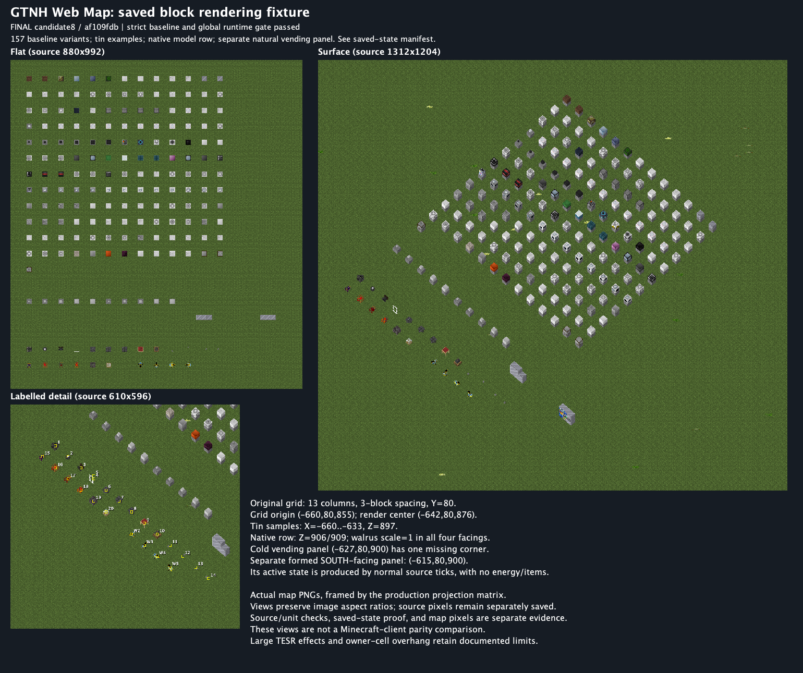
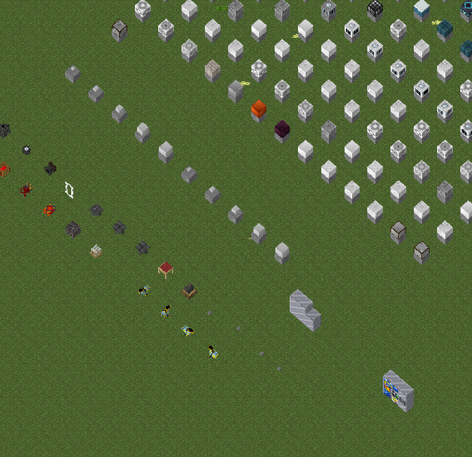

# Final installed-pack validation

Candidate `af109fdb407a937617cf2cdf69fcb9a2e562cd26` passes the strict baseline
and global runtime gate in the isolated loopback GTNH fixture. Its artifact is
`gtnh-web-map-af109fd.jar`, SHA-256
`5d91c7897e6491f59e41c7cf1d8c23d48ff8fd8bd82ab5831284c2214c0564e9`.

All 157 baseline variants are mapped. The complete installed registry has
3,412 mapped MTEs, with zero missing bases or unresolved iconsets. After fresh
flat/surface renders, the loaded resource pack reports **zero required missing
resources, texture-definition errors, and failed custom models**. The 25 CPU
harnesses passed in the integration checkout; the reconciliation policy's 14
tests also pass. `--fail-on-gaps` exits 0.

Every frozen baseline texture row is explained independently:

| Source-backed outcome | Rows |
| --- | ---: |
| Optional overlay absent by source contract | 270 |
| Unused declaration with registry/consumer proof | 277 |
| Loaded explicit material/procedural fallback | 22 |
| Observed replacement resource with source proof | 58 |
| Proven retirement or invisible helper base | 10 |
| **Total / unexplained gaps** | **637 / 0** |

The complete per-row ledger is
[runtime-fixture/final-baseline637-reconciliation.csv](runtime-fixture/final-baseline637-reconciliation.csv).
[The summary](runtime-fixture/final-validation-summary.json) preserves source,
artifact and raw-audit hashes. An unused or removed reference was never treated
as fixed without independent evidence; the global gate remains separate from
baseline bookkeeping.

Independent saved-region checks match all 169 cold placements (157 baseline
variants plus tin examples and extra vending machines), with processing
disabled, inactive state and zero stored energy. Twenty native-model tile
entities retain their expected classes, and four walruses retain metadata 2–5
and exact scale 1.0. The previous empty native chunk renders correctly after
fresh snapshots; the pump appears after the shared-PNG layout collision fix.
Nanochip modules reload their saved byte-array defaults without load errors.

A separate complete vending panel naturally becomes active through ordinary
server ticks, with no injected active flag, energy, inventory or trades. Its
actual five neighboring display graphics appear in the final surface output.
The deformed cold panel naturally clears active state. Tin examples are visible
with their different isolated thicknesses above the stone pedestals.

The final radius-64 jobs completed 400 flat and 776 surface tiles. All 1,176
original PNGs, hashes, commands and logs remain under
`/private/tmp/gwm-fixture/visual-scene/cycle8-*`; the raw audit is
`/private/tmp/gwm-fixture/cycle8-render-audit.json`. These committed images are
stitched from actual map PNGs with the production projection matrix.

The counts establish source/consumer and loader coverage, not exhaustive
Minecraft-client pixel parity. Active large TESR/shader effects and geometry
outside owner-cell traversal retain their documented limits. Restrictive-pipe
markings and connected end-cap design remain a follow-up; this release verifies
the originally missing tin pipes' visibility and sizes. Every optional absence,
retired helper base, and these visual limits remain explicit in the evidence.

Unchanged map tiles retain their file modification times. The final archive
therefore copies every coordinate from the original complete radius/projection
manifest, reading each current tile after the final completed renders; it does
not mistake unchanged files for missing output. The summary records changed
versus unchanged file counts separately.
